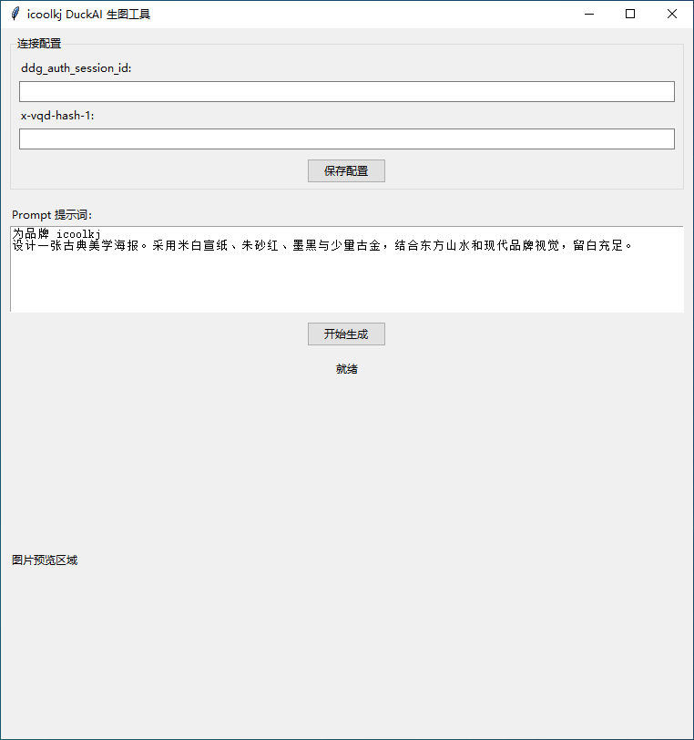
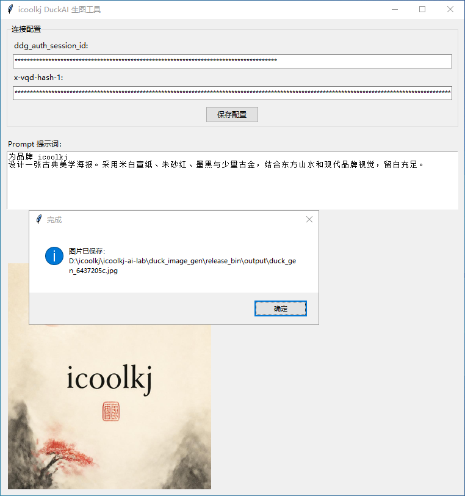

# icoolkj DuckAI 生图工具
Duck.ai API 文生图 GUI 工具




## 功能
1. 对接 Duck.ai 非公开接口，输入提示词一键文生图
2. GUI 配置面板，支持填写抓包凭证：`ddg_auth_session_id`、`x-vqd-hash-1`
3. 配置自动持久化保存到程序同级 `config.json`，下次打开无需重复填写
4. 后台线程请求，生成过程GUI不会卡顿
5. 自动校验返回图片，支持 JPEG / PNG / WebP 格式
6. 生成图片自动保存到程序同级 `output` 文件夹，文件名随机防覆盖
7. 生成完成内置图片预览

> ⚠️ 重要说明
> 本工具使用 Duck.ai **未公开私有接口**，接口没有稳定性保障，随时可能变更、限流、返回 418 拦截。
> - 418：服务端风控拒绝请求，无法通过修改代码绕过
> - 429：请求频率超限，请降低调用速度
> - 401/403：凭证失效，需要重新去 duck.ai 网页抓包获取最新参数
> - 仅用于技术学习研究，请勿商用。

## 使用方式
### 前置准备
需要从浏览器打开 duck.ai 网页，正常登录后抓包获取两个参数：
- `ddg_auth_session_id`
- `x-vqd-hash-1`

### 方式 1：源码直接运行

```bash
pip install -r requirements.txt
python duck_image_gen.py
```

### 方式 2：使用 PyInstaller 打包为 EXE

进入 `duck_image_gen` 目录，在终端中执行以下命令：

```bash
pyinstaller --noconfirm --onefile --windowed --distpath="./release_bin" --workpath="./build" --specpath="./" --name "icoolkj DuckAI生图工具" duck_image_gen.py
```

打包完成后，可在 `release_bin` 目录中找到生成的 EXE 文件。

## 许可证

Copyright © 2026 icoolkj.com
