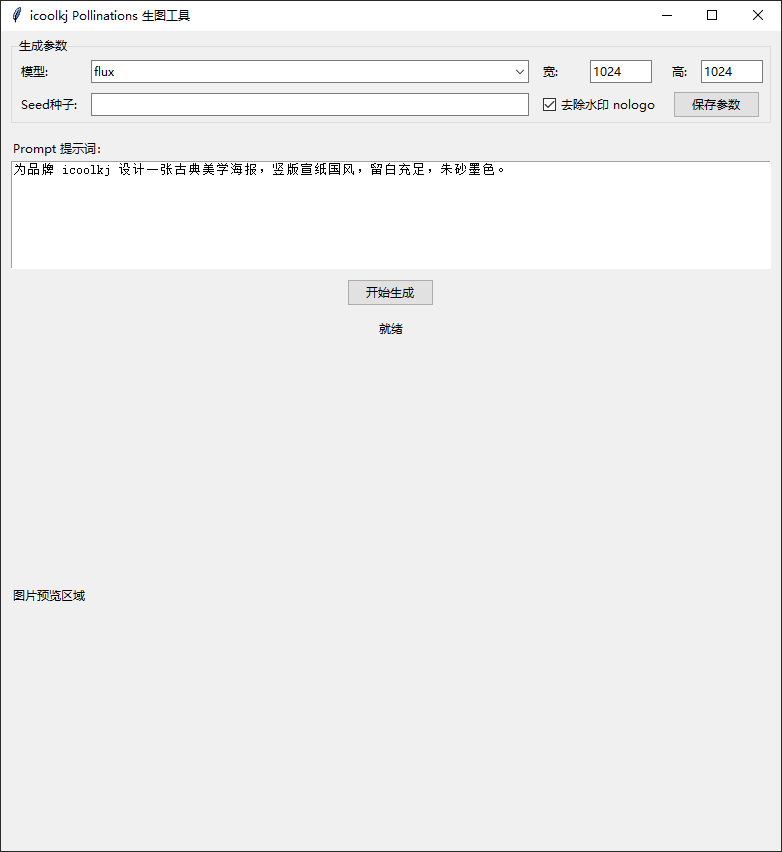
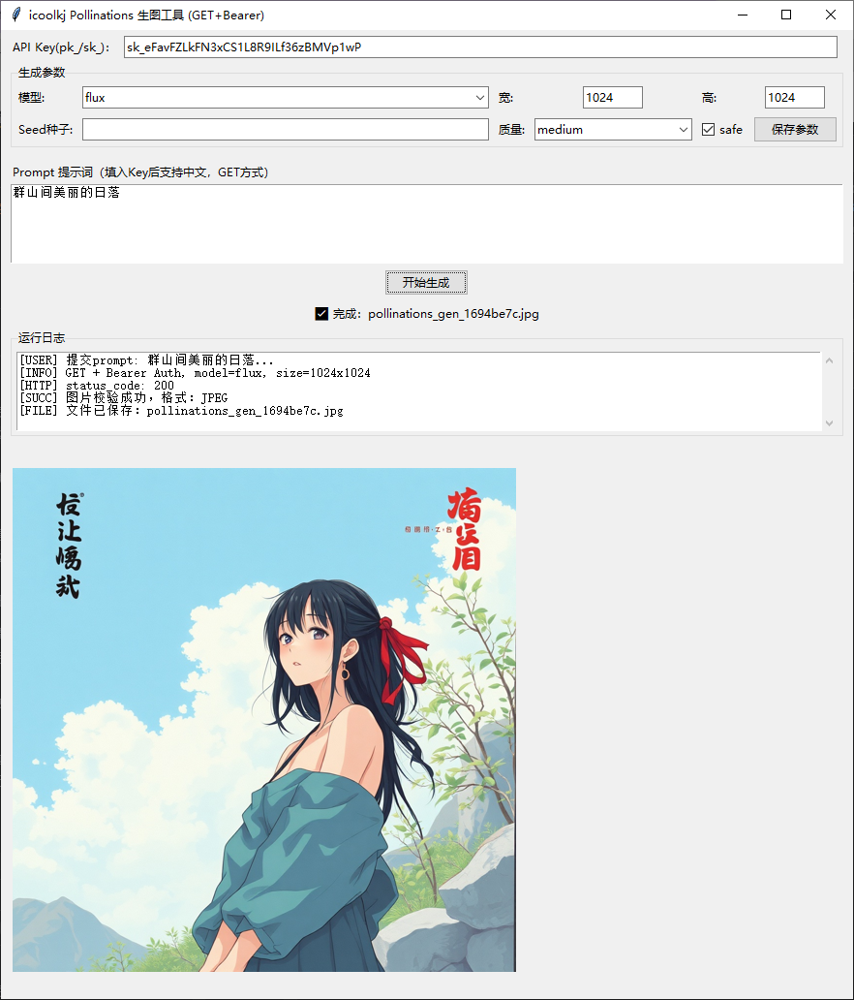

# icoolkj Pollinations 生图工具
对接 Pollinations AI GET 文生图接口：`https://gen.pollinations.ai/image/{prompt}`

## 界面预览





## 功能
1. 免费公共接口，**无需API Key**，直接输入提示词生成图片
2. 参数配置：模型选择、宽高尺寸、seed种子、去除水印
3. 参数持久化保存到 `config.json`
4. 后台异步请求，GUI不卡顿阻塞
5. 图片完整性校验，支持 JPG / PNG / WebP
6. 成品自动保存到同级 `output`，UUID命名防止覆盖
7. 内置预览面板，生成完成直接看图

> ⚠️ 重要说明
> 公共免费接口，存在限流 429、风控过滤，稳定性不保证，仅供技术学习研究。
> 可选模型：`flux` / `flux-realism` / `zimage` / `turbo`

## 使用方式
### 方式 1：源码直接运行

```bash
pip install -r requirements.txt
python pollinations_gen.py
```

### 方式 2：使用 PyInstaller 打包为 EXE

进入 `pollinations_gen` 目录，在终端中执行以下命令：

```bash
pyinstaller --noconfirm --onefile --windowed --distpath="./release_bin" --workpath="./build" --specpath="./" --name "icoolkj Pollinations生图工具" pollinations_gen.py
```

打包完成后，可在 `release_bin` 目录中找到生成的 EXE 文件。

## 许可证

Copyright © 2026 icoolkj.com
