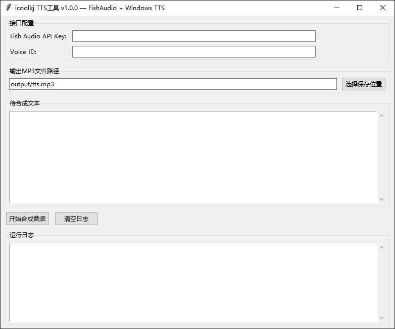
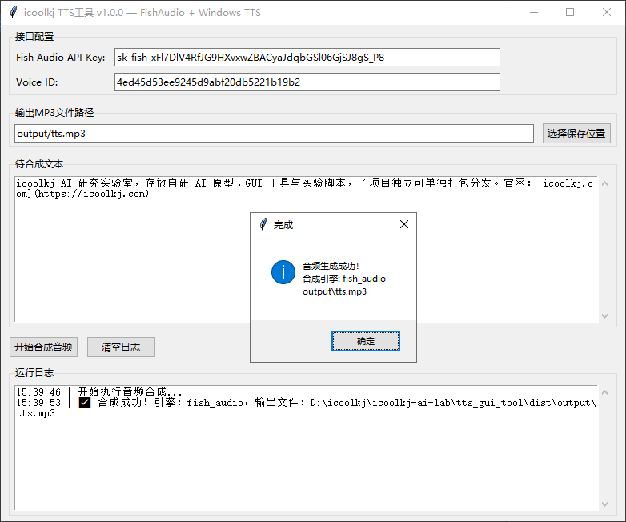

# icoolkj TTS 工具

FishAudio API + Windows 本地 TTS 语音合成 GUI

## 界面预览





## 功能

1. FishAudio 在线语音合成，填写 API Key 和 Voice ID 即可使用。
2. 在线接口异常时，自动降级到 Windows 原生 TTS。
3. 支持自定义 MP3 输出路径，提供图形化操作界面。

## 使用方式

### 方式 1：源码直接运行

```bash
pip install -r requirements.txt
python tts_gui_tool.py
```

### 方式 2：使用 PyInstaller 打包为 EXE

进入 `tts_gui_tool` 目录，在终端中执行以下命令：

```bash
pyinstaller --noconfirm --onefile --windowed --distpath="./release_bin" --workpath="./build" --specpath="./" --name "icoolkj TTS工具" tts_gui_tool.py
```

打包完成后，可在 `release_bin` 目录中找到生成的 EXE 文件。

## 许可证

Copyright © 2026 icoolkj.com
